# Laporan-Proyek-Jarkom

## Soal no 1,3 dan 5 (Sean)

### Step Pertama

Kita diminta untuk membuat topologi sesuai dengan skema CIDR yang telah dibuat.

- 1 router R-ISP + Server-PT "SRV-8.8.8.8"
  - 7 router: R-PUSAT, R-DC, R-UTARA, R-PELABUHAN, R-SELATAN, R-TIMUR, R-BARAT
  - 14 LAN. Tiap LAN: 1 switch (Switch 2960) + 1 perangkat perwakilan
    (soal: cukup 1 perangkat per LAN). LAN WiFi Publik: switch + Access Point
    + 1 laptop wireless.
  - Nama perangkat (sesuai soal: ganti nama bawaan):
    
    | LAN | Switch | Perangkat perwakilan |
    |---|---|---|
    | Pegawai Balai Kota | SW-PEGAWAI-BK | PC-PEGAWAI-BK |
    | Server Balai Kota | SW-SERVER-BK | SRV-BALAIKOTA |
    | CCTV Kota | SW-CCTV-KOTA | PC-CCTV-KOTA |
    | Server dan Storage DC | SW-SERVER-DC | SRV-DC |
    | WiFi Publik Utara | SW-WIFI-UTARA | AP-WIFI-UTARA + LAPTOP-WIFI-UTARA |
    | Sensor Lalu Lintas Utara | SW-SENSOR-LALIN | PC-SENSOR-LALIN |
    | Sensor dan SCADA Pelabuhan | SW-SCADA-PELABUHAN | PC-SCADA-PELABUHAN |
    | Kantor Pelabuhan | SW-KANTOR-PELABUHAN | PC-KANTOR-PELABUHAN |
    | WiFi Publik Selatan | SW-WIFI-SELATAN | AP-WIFI-SELATAN + LAPTOP-WIFI-SELATAN |
    | PJU Pintar Selatan | SW-PJU-SELATAN | PC-PJU-SELATAN |
    | WiFi Publik Timur | SW-WIFI-TIMUR | AP-WIFI-TIMUR + LAPTOP-WIFI-TIMUR |
    | Sensor Banjir Timur | SW-SENSOR-BANJIR | PC-SENSOR-BANJIR |
    | WiFi Publik Barat | SW-WIFI-BARAT | AP-WIFI-BARAT + LAPTOP-WIFI-BARAT |
    | Puskesmas dan Sekolah Barat | SW-PUSKESMAS-BARAT | PC-PUSKESMAS-BARAT |
 
Kabel
  - Router ke router (L1-L6, R-ISP ke R-PUSAT)  : Copper Cross-Over
  - R-ISP ke SRV-8.8.8.8                        : Copper Cross-Over
  - Router ke switch, switch ke PC/server/AP    : Copper Straight-Through
  - Laptop WiFi: ganti modul NIC dengan WPC300N (wireless), lalu
    hubungkan ke SSID pada AP.
  - Backbone wajib mengikuti Gambar 1: R-PUSAT ke R-DC (L1), R-UTARA (L2),
    R-SELATAN (L3), R-TIMUR (L4), R-BARAT (L5); R-UTARA ke R-PELABUHAN (L6);
    R-PUSAT ke R-ISP; R-ISP ke server 8.8.8.8.


### Pertimbangan desain
  1. Satu switch per LAN: router hanya butuh 1 port per LAN, dan perangkat
     baru bisa ditambah tanpa mengubah router.
  2. LAN WiFi Publik memakai AP dan perangkat wireless karena penggunanya
     publik dan bergerak, sedangkan LAN lain memakai kabel karena perangkat
     tetap (server, CCTV, sensor, SCADA, PC kantor) dan butuh koneksi stabil.
  3. Backbone antar-router memakai copper FastEthernet (cross-over) mengikuti Gambar 1.
     Tiap link memakai /30 agar hemat alamat.
  4. Router ditambah modul port FastEthernet sampai jumlah port cukup untuk satu port per
     link dan per LAN. Kebutuhan port: R-PUSAT 8 port (1 ke R-ISP, 5 link L1-L5, dan 2 LAN),
     R-UTARA 4 port, R-DC 3 port, R-PELABUHAN, R-SELATAN, R-TIMUR, dan R-BARAT masing-masing
     3 port, serta R-ISP 2 port. Link cadangan L7 (R-DC ke R-UTARA) tidak dipasang pada file
     utama; port tambahannya baru disiapkan pada file OSPF (Soal 7).
  5. Server (SRV-DC, SRV-BALAIKOTA) ditempatkan di LAN tersendiri supaya
     layanan terpisah dari perangkat pengguna.

## Skema CIDR - Kelompok 12

## Tabel Interface dan IP

| Router | Port | IP Address | Mask | Prefix | Tersambung ke |
|---|---|---|---|---|---|
| R-ISP | Fa0/0 | 203.0.113.49 | 255.255.255.252 | /30 | KE R-PUSAT |
| R-ISP | Fa1/0 | 8.8.8.1 | 255.255.255.0 | /24 | KE SERVER 8.8.8.8 |
| R-PUSAT | Fa0/0 | 203.0.113.50 | 255.255.255.252 | /30 | KE R-ISP |
| R-PUSAT | Fa1/0 | 10.98.64.1 | 255.255.255.252 | /30 | L1 KE R-DC |
| R-PUSAT | Fa7/0 | 10.98.194.1 | 255.255.255.252 | /30 | L2 KE R-UTARA |
| R-PUSAT | Fa9/0 | 10.97.192.1 | 255.255.255.252 | /30 | L3 KE R-SELATAN |
| R-PUSAT | Fa8/0 | 10.97.64.1 | 255.255.255.252 | /30 | L4 KE R-TIMUR |
| R-PUSAT | Fa6/0 | 10.96.64.1 | 255.255.255.252 | /30 | L5 KE R-BARAT |
| R-PUSAT | Fa5/0 | 10.99.0.1 | 255.255.248.0 | /21 | LAN Pegawai Balai Kota |
| R-PUSAT | Fa4/0 | 10.99.8.1 | 255.255.255.224 | /27 | LAN Server Balai Kota |
| R-DC | Fa0/0 | 10.98.64.2 | 255.255.255.252 | /30 | L1 KE R-PUSAT |
| R-DC | Fa6/0 | 10.98.0.1 | 255.255.224.0 | /19 | LAN CCTV Kota |
| R-DC | Fa1/0 | 10.98.32.1 | 255.255.255.0 | /24 | LAN Server & Storage DC |
| R-UTARA | Fa0/0 | 10.98.194.2 | 255.255.255.252 | /30 | L2 KE R-PUSAT |
| R-UTARA | Fa7/0 | 10.96.192.1 | 255.255.255.252 | /30 | L6 KE R-PELABUHAN |
| R-UTARA | Fa1/0 | 10.98.128.1 | 255.255.192.0 | /18 | LAN WiFi Publik Utara |
| R-UTARA | Fa6/0 | 10.98.192.1 | 255.255.254.0 | /23 | LAN Sensor Lalu Lintas Utara |
| R-PELABUHAN | Fa1/0 | 10.96.192.2 | 255.255.255.252 | /30 | L6 KE R-UTARA |
| R-PELABUHAN | Fa0/0 | 10.96.128.1 | 255.255.224.0 | /19 | LAN Sensor & SCADA Pelabuhan |
| R-PELABUHAN | Fa6/0 | 10.96.160.1 | 255.255.255.128 | /25 | LAN Kantor Pelabuhan |
| R-SELATAN | Fa0/0 | 10.97.192.2 | 255.255.255.252 | /30 | L3 KE R-PUSAT |
| R-SELATAN | Fa1/0 | 10.97.128.1 | 255.255.224.0 | /19 | LAN WiFi Publik Selatan |
| R-SELATAN | Fa6/0 | 10.97.160.1 | 255.255.255.128 | /25 | LAN PJU Pintar Selatan |
| R-TIMUR | Fa0/0 | 10.97.64.2 | 255.255.255.252 | /30 | L4 KE R-PUSAT |
| R-TIMUR | Fa1/0 | 10.97.0.1 | 255.255.224.0 | /19 | LAN WiFi Publik Timur |
| R-TIMUR | Fa6/0 | 10.97.32.1 | 255.255.252.0 | /22 | LAN Sensor Banjir Timur |
| R-BARAT | Fa0/0 | 10.96.64.2 | 255.255.255.252 | /30 | L5 KE R-PUSAT |
| R-BARAT | Fa1/0 | 10.96.0.1 | 255.255.224.0 | /19 | LAN WiFi Publik Barat |
| R-BARAT | Fa6/0 | 10.96.32.1 | 255.255.255.0 | /24 | LAN Puskesmas & Sekolah Barat |

## Label LAN

| Switch | Nama Subnet | Network ID/Prefix | Jumlah Host |
|---|---|---|---|
| SW-PEGAWAI-BK | Pegawai Balai Kota | 10.99.0.0/21 | 1.800 |
| SW-SERVER-BK | Server Balai Kota | 10.99.8.0/27 | 20 |
| SW-CCTV-KOTA | CCTV Kota | 10.98.0.0/19 | 6.000 |
| SW-SERVER-DC | Server & Storage DC | 10.98.32.0/24 | 180 |
| SW-WIFI-UTARA | WiFi Publik Utara | 10.98.128.0/18 | 11.000 |
| SW-SENSOR-LALIN | Sensor Lalu Lintas Utara | 10.98.192.0/23 | 450 |
| SW-SCADA-PELABUHAN | Sensor & SCADA Pelabuhan | 10.96.128.0/19 | 5.000 |
| SW-KANTOR-PELABUHAN | Kantor Pelabuhan | 10.96.160.0/25 | 120 |
| SW-WIFI-SELATAN | WiFi Publik Selatan | 10.97.128.0/19 | 6.500 |
| SW-PJU-SELATAN | PJU Pintar Selatan | 10.97.160.0/25 | 90 |
| SW-WIFI-TIMUR | WiFi Publik Timur | 10.97.0.0/19 | 5.500 |
| SW-SENSOR-BANJIR | Sensor Banjir Timur | 10.97.32.0/22 | 700 |
| SW-WIFI-BARAT | WiFi Publik Barat | 10.96.0.0/19 | 4.500 |
| SW-PUSKESMAS-BARAT | Puskesmas & Sekolah Barat | 10.96.32.0/24 | 220 |

## Static Route

| Router | Network Tujuan | Next Hop | Keterangan |
|---|---|---|---|
| R-PUSAT | 0.0.0.0/0 | 203.0.113.49 | default ke R-ISP |
| R-PUSAT | 10.98.0.0/17 | 10.98.64.2 | ke R-DC |
| R-PUSAT | 10.98.128.0/17 | 10.98.194.2 | ke R-UTARA |
| R-PUSAT | 10.96.128.0/17 | 10.98.194.2 | ke R-PELABUHAN |
| R-PUSAT | 10.97.128.0/17 | 10.97.192.2 | ke R-SELATAN |
| R-PUSAT | 10.97.0.0/17 | 10.97.64.2 | ke R-TIMUR |
| R-PUSAT | 10.96.0.0/17 | 10.96.64.2 | ke R-BARAT |
| R-UTARA | 0.0.0.0/0 | 10.98.194.1 | default ke R-PUSAT |
| R-UTARA | 10.96.128.0/17 | 10.96.192.2 | ke R-PELABUHAN |
| R-DC | 0.0.0.0/0 | 10.98.64.1 | default ke R-PUSAT |
| R-BARAT | 0.0.0.0/0 | 10.96.64.1 | default ke R-PUSAT |
| R-TIMUR | 0.0.0.0/0 | 10.97.64.1 | default ke R-PUSAT |
| R-SELATAN | 0.0.0.0/0 | 10.97.192.1 | default ke R-PUSAT |
| R-PELABUHAN | 0.0.0.0/0 | 10.96.192.1 | default ke R-UTARA |

### Alasan Pemilihan Skema CIDR

Proyek ini menggunakan skema CIDR (supernetting) dengan blok `10.96.0.0/14`. Alasannya:

1. **Static route lebih ringkas.** Blok setiap cabang disusun hierarkis, sehingga R-PUSAT
   cukup memiliki satu rute ringkasan /17 per cabang (6 rute), dan R-UTARA satu rute
   ke blok R-PELABUHAN. Pada skema VLSM, R-PUSAT membutuhkan satu rute per LAN (12 rute)
   dan R-UTARA dua rute. Rute yang lebih sedikit mengurangi risiko salah ketik dan
   mempermudah pemeriksaan.
2. **Mudah dikembangkan.** Penambahan LAN baru di dalam blok sebuah cabang tidak
   mengubah konfigurasi R-PUSAT, karena rute ringkasannya sudah mencakup seluruh blok.
3. **Sesuai kebutuhan Soal 3.** Aturan default route ke atas dan rute ke bawah di
   R-PUSAT serta R-UTARA dapat dipenuhi dengan jumlah rute yang kecil.

**Trade-off.** CIDR kurang hemat alamat karena blok tiap cabang dibulatkan ke pangkat 2.
Dari total kebutuhan 61.752 alamat, CIDR memakai kapasitas /14 (262.144 alamat) sehingga
pemakaiannya 23,56%, sedangkan VLSM cukup /16 (65.536 alamat) dengan pemakaian 94,23%.
Pemborosan ini dapat diterima karena ruang privat `10.0.0.0/8` masih sangat longgar dan
seluruh blok /14 masih berada dalam jatah alamat kelompok (10.96.0.0 - 10.103.255.255).

### Penjelasan Konfigurasi

**Pengalamatan.** Gateway tiap LAN adalah host pertama subnet dan dipasang pada
interface router. Link L1-L5 memakai /30 dengan R-PUSAT di alamat .1 dan router
cabang di .2; pada L6 R-UTARA .1 dan R-PELABUHAN .2. Link R-ISP ke R-PUSAT memakai
203.0.113.48/30 (4 x K, K = 12). Server 8.8.8.8 memakai 8.8.8.8/24 dengan gateway 8.8.8.1.

**Static routing.** Default route hanya mengarah ke router di atas atau ke luar:
R-DC, R-BARAT, R-TIMUR, dan R-SELATAN ke R-PUSAT, R-PELABUHAN ke R-UTARA, serta
R-PUSAT ke R-ISP. R-PUSAT memiliki satu rute ringkasan /17 per cabang (R-DC, R-UTARA,
R-PELABUHAN via R-UTARA, R-SELATAN, R-TIMUR, R-BARAT), sedangkan R-UTARA memiliki
rute ke blok R-PELABUHAN 10.96.128.0/17. Ringkasan ini berlaku karena tiap blok /17
sudah mencakup LAN dan link milik cabang tersebut.

**NAT.** R-PUSAT memakai PAT (overload) pada interface Fa0/0 (outside); semua interface
lain adalah inside. ACL NAT-INTERNAL mengizinkan blok privat kelompok 10.96.0.0/14,
sehingga semua host berbagi satu IP publik 203.0.113.50. R-ISP sengaja tanpa rute privat.

**Alamat PC saat pengujian.** Karena DHCP dikerjakan pada Soal 4, PC perwakilan
sementara memakai IP statis host ke-2 tiap subnet (misalnya PC-Pegawai-Bk
10.99.0.2/21, gateway 10.99.0.1).

### Masukkan skrip ke setiap Router

-- Skrip CLI per Router 

```
!----- R-ISP -----
enable
configure terminal
hostname R-ISP
no ip domain-lookup
interface FastEthernet0/0
 description KE R-PUSAT
 ip address 203.0.113.49 255.255.255.252
 no shutdown
exit
interface FastEthernet1/0
 description KE SERVER 8.8.8.8
 ip address 8.8.8.1 255.255.255.0
 no shutdown
exit
! TIDAK ada ip route apa pun di R-ISP (tidak boleh punya rute ke alamat privat)
end
write memory
```

```
!----- R-PUSAT -----
enable
configure terminal
hostname R-PUSAT
no ip domain-lookup
interface FastEthernet0/0
 description KE R-ISP
 ip address 203.0.113.50 255.255.255.252
 ip nat outside
 no shutdown
exit
interface FastEthernet1/0
 description L1 KE R-DC
 ip address 10.98.64.1 255.255.255.252
 ip nat inside
 no shutdown
exit
interface FastEthernet7/0
 description L2 KE R-UTARA
 ip address 10.98.194.1 255.255.255.252
 ip nat inside
 no shutdown
exit
interface FastEthernet9/0
 description L3 KE R-SELATAN
 ip address 10.97.192.1 255.255.255.252
 ip nat inside
 no shutdown
exit
interface FastEthernet8/0
 description L4 KE R-TIMUR
 ip address 10.97.64.1 255.255.255.252
 ip nat inside
 no shutdown
exit
interface FastEthernet6/0
 description L5 KE R-BARAT
 ip address 10.96.64.1 255.255.255.252
 ip nat inside
 no shutdown
exit
interface FastEthernet5/0
 description LAN Pegawai Balai Kota
 ip address 10.99.0.1 255.255.248.0
 ip nat inside
 no shutdown
exit
interface FastEthernet4/0
 description LAN Server Balai Kota
 ip address 10.99.8.1 255.255.255.224
 ip nat inside
 no shutdown
exit
! default ke R-ISP
ip route 0.0.0.0 0.0.0.0 203.0.113.49
! ke R-DC
ip route 10.98.0.0 255.255.128.0 10.98.64.2
! ke R-UTARA
ip route 10.98.128.0 255.255.128.0 10.98.194.2
! ke R-PELABUHAN
ip route 10.96.128.0 255.255.128.0 10.98.194.2
! ke R-SELATAN
ip route 10.97.128.0 255.255.128.0 10.97.192.2
! ke R-TIMUR
ip route 10.97.0.0 255.255.128.0 10.97.64.2
! ke R-BARAT
ip route 10.96.0.0 255.255.128.0 10.96.64.2
ip access-list standard NAT-INTERNAL
 permit 10.96.0.0 0.3.255.255
 deny any
exit
ip nat inside source list NAT-INTERNAL interface FastEthernet0/0 overload
end
write memory
```

```
!----- R-DC -----
enable
configure terminal
hostname R-DC
no ip domain-lookup
interface FastEthernet0/0
 description L1 KE R-PUSAT
 ip address 10.98.64.2 255.255.255.252
 no shutdown
exit
interface FastEthernet6/0
 description LAN CCTV Kota
 ip address 10.98.0.1 255.255.224.0
 no shutdown
exit
interface FastEthernet1/0
 description LAN Server & Storage DC
 ip address 10.98.32.1 255.255.255.0
 no shutdown
exit
! default ke R-PUSAT
ip route 0.0.0.0 0.0.0.0 10.98.64.1
end
write memory
```
```
!----- R-UTARA -----
enable
configure terminal
hostname R-UTARA
no ip domain-lookup
interface FastEthernet0/0
 description L2 KE R-PUSAT
 ip address 10.98.194.2 255.255.255.252
 no shutdown
exit
interface FastEthernet7/0
 description L6 KE R-PELABUHAN
 ip address 10.96.192.1 255.255.255.252
 no shutdown
exit
interface FastEthernet1/0
 description LAN WiFi Publik Utara
 ip address 10.98.128.1 255.255.192.0
 no shutdown
exit
interface FastEthernet6/0
 description LAN Sensor Lalu Lintas Utara
 ip address 10.98.192.1 255.255.254.0
 no shutdown
exit
! default ke R-PUSAT
ip route 0.0.0.0 0.0.0.0 10.98.194.1
! ke R-PELABUHAN
ip route 10.96.128.0 255.255.128.0 10.96.192.2
end
write memory
```

```
!----- R-PELABUHAN -----
enable
configure terminal
hostname R-PELABUHAN
no ip domain-lookup
interface FastEthernet1/0
 description L6 KE R-UTARA
 ip address 10.96.192.2 255.255.255.252
 no shutdown
exit
interface FastEthernet0/0
 description LAN Sensor & SCADA Pelabuhan
 ip address 10.96.128.1 255.255.224.0
 no shutdown
exit
interface FastEthernet6/0
 description LAN Kantor Pelabuhan
 ip address 10.96.160.1 255.255.255.128
 no shutdown
exit
! default ke R-UTARA
ip route 0.0.0.0 0.0.0.0 10.96.192.1
end
write memory
```

```
!----- R-SELATAN -----
enable
configure terminal
hostname R-SELATAN
no ip domain-lookup
interface FastEthernet0/0
 description L3 KE R-PUSAT
 ip address 10.97.192.2 255.255.255.252
 no shutdown
exit
interface FastEthernet1/0
 description LAN WiFi Publik Selatan
 ip address 10.97.128.1 255.255.224.0
 no shutdown
exit
interface FastEthernet6/0
 description LAN PJU Pintar Selatan
 ip address 10.97.160.1 255.255.255.128
 no shutdown
exit
! default ke R-PUSAT
ip route 0.0.0.0 0.0.0.0 10.97.192.1
end
write memory
```

```
!----- R-TIMUR -----
enable
configure terminal
hostname R-TIMUR
no ip domain-lookup
interface FastEthernet0/0
 description L4 KE R-PUSAT
 ip address 10.97.64.2 255.255.255.252
 no shutdown
exit
interface FastEthernet1/0
 description LAN WiFi Publik Timur
 ip address 10.97.0.1 255.255.224.0
 no shutdown
exit
interface FastEthernet6/0
 description LAN Sensor Banjir Timur
 ip address 10.97.32.1 255.255.252.0
 no shutdown
exit
! default ke R-PUSAT
ip route 0.0.0.0 0.0.0.0 10.97.64.1
end
write memory
```

```
!----- R-BARAT -----
enable
configure terminal
hostname R-BARAT
no ip domain-lookup
interface FastEthernet0/0
 description L5 KE R-PUSAT
 ip address 10.96.64.2 255.255.255.252
 no shutdown
exit
interface FastEthernet1/0
 description LAN WiFi Publik Barat
 ip address 10.96.0.1 255.255.224.0
 no shutdown
exit
interface FastEthernet6/0
 description LAN Puskesmas & Sekolah Barat
 ip address 10.96.32.1 255.255.255.0
 no shutdown
exit
! default ke R-PUSAT
ip route 0.0.0.0 0.0.0.0 10.96.64.1
end
write memory
```

### Pengujian 

- Pengujian di CLI Router

  - Di semua router

    Memastikan semua port up/up

    ```show ip interface brief```

    Mencocokan rute dengan tabel

    ```show ip route static```  

    

- Pengujian di Router Pusat
  
  - Mengecek default route ke R-ISP

    ```show ip route | include 0.0.0.0```

  - Cek fungsi NAT
 
    ```show ip nat translations```

    ```show ip nat statistics```

  

- Pengujin di R-ISP
  
  - Memastikan tidak ada rute ke IP Private
 
    ```show ip route```

    

    Dari `show ip route` terlihat R-ISP hanya memiliki dua rute terhubung langsung (203.0.113.48/30 dan 8.8.8.0/24) dan tidak ada rute ke alamat privat, sesuai ketentuan        soal.

  - Lakukan ping ke salah satu alamat privat yang hasilnya harus gagal
    
    Disini aku melakukan ping ke PC-Pegawai-Bk
 
    ```ping 10.99.0.2```
    
    

    Ping dari R-ISP ke 10.99.0.2 gagal karena R-ISP tidak memiliki rute ke jaringan internal, sehingga jaringan privat tidak terekspos ke sisi internet. Bukti NAT bekerja       ada pada `ping 8.8.8.8` dari PC yang berhasil dan `show ip nat translations` yang menunjukkan alamat privat diterjemahkan menjadi 203.0.113.50.

- Pengujian di PC

  - Tes Antar-LAN 1:
    Dari PC-Puskesmas-Barat ping ke PC-Scada-Pelabuhan:
    
    ```ping 10.96.128.2```
    
    

  - Tes Antar-LAN 2:
    Dari PC-Cctv-Kota ping ke PC-Sensor-Banjir:

    ```ping 10.97.32.2```

    

  - Tes jalur tracert
    Dari PC-Kantor-Pelabuhan ke PC-Pegawai-Bk, harusnya lewat R-UTARA (10.96.192.1) dan R-PUSAT(10.98.194.1).

    ```tracert 10.99.0.2```

    

    Dari foto diatas kita bisa melihat bahwa jalur yang dilewati PC-Kantor-Pelabuhan ke PC-Pegawai-Bk berhasil melewati R-UTARA (10.96.192.1) dan R-PUSAT(10.98.194.1).

  - Tes internet

    ```ping 8.8.8.8```

    


## Soal no 4 dan 8 (Boma)

### Soal 4 - DHCP

Kita diminta supaya semua perangkat pengguna (PC, laptop) mendapat IP, gateway, dan DNS secara otomatis dari DHCP, sedangkan interface router dan server tetap memakai IP statis.

- 10 LAN pengguna dilayani DHCP oleh router tempat LAN itu terhubung (`ip dhcp pool`).
- LAN CCTV Kota adalah pengecualian: alamatnya harus datang dari **server DHCP di LAN Server dan Storage DC (SRV-DC, 10.98.32.2)**, bukan dari R-DC. Karena request DHCP berupa broadcast dan broadcast tidak melewati router, R-DC diberi `ip helper-address 10.98.32.2` pada interface LAN CCTV (Fa6/0) sebagai DHCP relay.
- LAN Server Balai Kota dan LAN Server & Storage DC tidak memakai DHCP karena isinya server dengan IP statis.
- Alamat `.1` sampai `.10` di tiap LAN di-exclude (`.1` = gateway, sisanya cadangan IP statis), jadi lease pertama selalu `.11` dan tidak bentrok dengan alamat statis.
- Semua pool memberi DNS `10.98.32.2` (SRV-DC) karena semua layanan Soal 8 diakses lewat nama domain `k12.smartcity.lab`.

### Tabel Pool DHCP

| Sumber | LAN | Network | Mask | Gateway | DNS | Lease pertama |
|---|---|---|---|---|---|---|
| R-PUSAT | Pegawai Balai Kota | 10.99.0.0/21 | 255.255.248.0 | 10.99.0.1 | 10.98.32.2 | 10.99.0.11 |
| R-UTARA | WiFi Publik Utara | 10.98.128.0/18 | 255.255.192.0 | 10.98.128.1 | 10.98.32.2 | 10.98.128.11 |
| R-UTARA | Sensor Lalu Lintas Utara | 10.98.192.0/23 | 255.255.254.0 | 10.98.192.1 | 10.98.32.2 | 10.98.192.11 |
| R-PELABUHAN | Sensor & SCADA Pelabuhan | 10.96.128.0/19 | 255.255.224.0 | 10.96.128.1 | 10.98.32.2 | 10.96.128.11 |
| R-PELABUHAN | Kantor Pelabuhan | 10.96.160.0/25 | 255.255.255.128 | 10.96.160.1 | 10.98.32.2 | 10.96.160.11 |
| R-SELATAN | WiFi Publik Selatan | 10.97.128.0/19 | 255.255.224.0 | 10.97.128.1 | 10.98.32.2 | 10.97.128.11 |
| R-SELATAN | PJU Pintar Selatan | 10.97.160.0/25 | 255.255.255.128 | 10.97.160.1 | 10.98.32.2 | 10.97.160.11 |
| R-TIMUR | WiFi Publik Timur | 10.97.0.0/19 | 255.255.224.0 | 10.97.0.1 | 10.98.32.2 | 10.97.0.11 |
| R-TIMUR | Sensor Banjir Timur | 10.97.32.0/22 | 255.255.252.0 | 10.97.32.1 | 10.98.32.2 | 10.97.32.11 |
| R-BARAT | WiFi Publik Barat | 10.96.0.0/19 | 255.255.224.0 | 10.96.0.1 | 10.98.32.2 | 10.96.0.11 |
| R-BARAT | Puskesmas & Sekolah Barat | 10.96.32.0/24 | 255.255.255.0 | 10.96.32.1 | 10.98.32.2 | 10.96.32.11 |
| **SRV-DC** | **CCTV Kota (via relay R-DC)** | 10.98.0.0/19 | 255.255.224.0 | 10.98.0.1 | 10.98.32.2 | 10.98.0.11 |

### Masukkan skrip DHCP ke setiap Router

-- Skrip CLI DHCP per Router

```
!----- R-PUSAT -----
enable
configure terminal
ip dhcp excluded-address 10.99.0.1 10.99.0.10
ip dhcp pool PEGAWAI-BALAIKOTA
 network 10.99.0.0 255.255.248.0
 default-router 10.99.0.1
 dns-server 10.98.32.2
 domain-name k12.smartcity.lab
exit
end
write memory
```

```
!----- R-UTARA -----
enable
configure terminal
ip dhcp excluded-address 10.98.128.1 10.98.128.10
ip dhcp excluded-address 10.98.192.1 10.98.192.10
ip dhcp pool WIFI-UTARA
 network 10.98.128.0 255.255.192.0
 default-router 10.98.128.1
 dns-server 10.98.32.2
 domain-name k12.smartcity.lab
exit
ip dhcp pool SENSOR-LALIN-UTARA
 network 10.98.192.0 255.255.254.0
 default-router 10.98.192.1
 dns-server 10.98.32.2
 domain-name k12.smartcity.lab
exit
end
write memory
```

```
!----- R-PELABUHAN -----
enable
configure terminal
ip dhcp excluded-address 10.96.128.1 10.96.128.10
ip dhcp excluded-address 10.96.160.1 10.96.160.10
ip dhcp pool SCADA-PELABUHAN
 network 10.96.128.0 255.255.224.0
 default-router 10.96.128.1
 dns-server 10.98.32.2
 domain-name k12.smartcity.lab
exit
ip dhcp pool KANTOR-PELABUHAN
 network 10.96.160.0 255.255.255.128
 default-router 10.96.160.1
 dns-server 10.98.32.2
 domain-name k12.smartcity.lab
exit
end
write memory
```

```
!----- R-SELATAN -----
enable
configure terminal
ip dhcp excluded-address 10.97.128.1 10.97.128.10
ip dhcp excluded-address 10.97.160.1 10.97.160.10
ip dhcp pool WIFI-SELATAN
 network 10.97.128.0 255.255.224.0
 default-router 10.97.128.1
 dns-server 10.98.32.2
 domain-name k12.smartcity.lab
exit
ip dhcp pool PJU-SELATAN
 network 10.97.160.0 255.255.255.128
 default-router 10.97.160.1
 dns-server 10.98.32.2
 domain-name k12.smartcity.lab
exit
end
write memory
```

```
!----- R-TIMUR -----
enable
configure terminal
ip dhcp excluded-address 10.97.0.1 10.97.0.10
ip dhcp excluded-address 10.97.32.1 10.97.32.10
ip dhcp pool WIFI-TIMUR
 network 10.97.0.0 255.255.224.0
 default-router 10.97.0.1
 dns-server 10.98.32.2
 domain-name k12.smartcity.lab
exit
ip dhcp pool SENSOR-BANJIR-TIMUR
 network 10.97.32.0 255.255.252.0
 default-router 10.97.32.1
 dns-server 10.98.32.2
 domain-name k12.smartcity.lab
exit
end
write memory
```

```
!----- R-BARAT -----
enable
configure terminal
ip dhcp excluded-address 10.96.0.1 10.96.0.10
ip dhcp excluded-address 10.96.32.1 10.96.32.10
ip dhcp pool WIFI-BARAT
 network 10.96.0.0 255.255.224.0
 default-router 10.96.0.1
 dns-server 10.98.32.2
 domain-name k12.smartcity.lab
exit
ip dhcp pool PUSKESMAS-SEKOLAH-BARAT
 network 10.96.32.0 255.255.255.0
 default-router 10.96.32.1
 dns-server 10.98.32.2
 domain-name k12.smartcity.lab
exit
end
write memory
```

```
!----- R-DC (tanpa pool, hanya DHCP relay ke SRV-DC) -----
enable
configure terminal
interface FastEthernet6/0
 description LAN CCTV Kota
 ip helper-address 10.98.32.2
exit
end
write memory
```

### Konfigurasi Server DHCP di SRV-DC (untuk CCTV Kota)

- Desktop > IP Configuration > Static: IP `10.98.32.2`, mask `255.255.255.0`, gateway `10.98.32.1`, DNS `10.98.32.2`.
- Services > DHCP: Service **On**, lalu tambah pool baru:

  | Field | Isi |
  |---|---|
  | Pool Name | CCTV-KOTA |
  | Default Gateway | 10.98.0.1 |
  | DNS Server | 10.98.32.2 |
  | Start IP | 10.98.0.11 |
  | Subnet Mask | 255.255.224.0 |
  | Max Users | 999 |

Cara kerjanya: request DHCP dari PC-Cctv-Kota sampai ke R-DC sebagai broadcast, lalu R-DC meneruskannya ke 10.98.32.2 dengan `giaddr = 10.98.0.1`. SRV-DC memilih pool CCTV-KOTA berdasarkan giaddr tersebut, dan offer dikirim balik lewat R-DC ke PC-Cctv-Kota.

### Konfigurasi Klien

Semua PC/Laptop perwakilan diubah ke Desktop > IP Configuration > **DHCP** (IP statis `.2` yang dipakai saat pengujian Soal 3 dihapus dulu). Laptop WiFi harus terhubung dulu ke SSID AP-nya lewat Desktop > PC Wireless, baru meminta alamat.

**Catatan perbaikan.** Saat pengujian, PC-Sensor-Banjir tidak mendapat alamat walaupun pool `SENSOR-BANJIR-TIMUR` di R-TIMUR sudah benar (Fa6/0 10.97.32.1/22 up/up, tetapi leased 0). Setelah dicek dengan `show ip interface brief` di Sw-Sensor-Banjir, ternyata kabel PC ke switch belum terpasang. Setelah ditambahkan kabel Copper Straight-Through dari PC-Sensor-Banjir Fa0 ke Sw-Sensor-Banjir Fa1/1, PC langsung mendapat 10.97.32.11.

### Pengujian Soal 4

Hasil DHCP di 12 klien perwakilan:

| Klien | IP | Mask | Gateway | DNS | Sumber |
|---|---|---|---|---|---|
| PC-Pegawai-Bk | 10.99.0.11 | 255.255.248.0 | 10.99.0.1 | 10.98.32.2 | R-PUSAT |
| PC-Cctv-Kota | 10.98.0.11 | 255.255.224.0 | 10.98.0.1 | 10.98.32.2 | SRV-DC (relay R-DC) |
| PC-Sensor-Lalin | 10.98.192.11 | 255.255.254.0 | 10.98.192.1 | 10.98.32.2 | R-UTARA |
| Laptop-Wifi-Utara | 10.98.128.11 | 255.255.192.0 | 10.98.128.1 | 10.98.32.2 | R-UTARA |
| PC-Scada-Pelabuhan | 10.96.128.11 | 255.255.224.0 | 10.96.128.1 | 10.98.32.2 | R-PELABUHAN |
| PC-Kantor-Pelabuhan | 10.96.160.11 | 255.255.255.128 | 10.96.160.1 | 10.98.32.2 | R-PELABUHAN |
| Laptop-Wifi-Selatan | 10.97.128.11 | 255.255.224.0 | 10.97.128.1 | 10.98.32.2 | R-SELATAN |
| PC-PJU-Selatan | 10.97.160.11 | 255.255.255.128 | 10.97.160.1 | 10.98.32.2 | R-SELATAN |
| Laptop-Wifi-Timur | 10.97.0.11 | 255.255.224.0 | 10.97.0.1 | 10.98.32.2 | R-TIMUR |
| PC-Sensor-Banjir | 10.97.32.11 | 255.255.252.0 | 10.97.32.1 | 10.98.32.2 | R-TIMUR |
| Laptop-Wifi-Barat | 10.96.0.11 | 255.255.224.0 | 10.96.0.1 | 10.98.32.2 | R-BARAT |
| PC-Puskesmas-Barat | 10.96.32.11 | 255.255.255.0 | 10.96.32.1 | 10.98.32.2 | R-BARAT |

Semua klien mendapat lease pertama `.11`, gateway = host pertama subnet, dan DNS 10.98.32.2. Tidak ada klien yang mendapat `.1` sampai `.10`, jadi tidak bentrok dengan alamat statis.

- Wilayah Balai Kota dan Command Center

  - PC-Pegawai-Bk (DHCP dari R-PUSAT)

    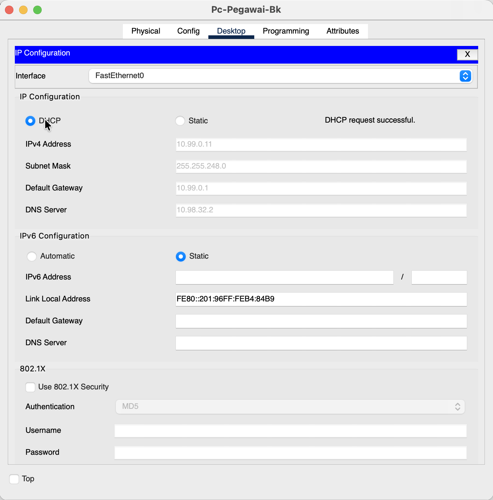

  - PC-Cctv-Kota (DHCP dari SRV-DC lewat relay R-DC)

    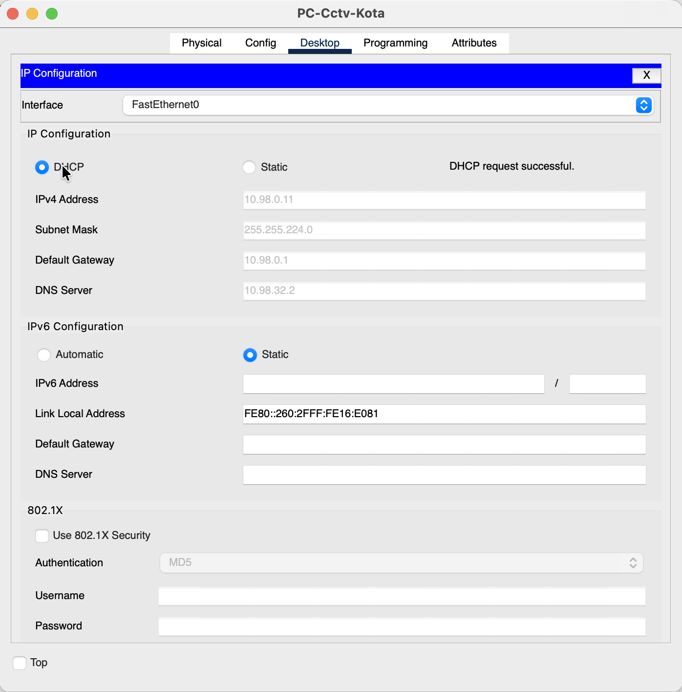

    PC-Cctv-Kota mendapat 10.98.0.11 dari pool CCTV-KOTA di SRV-DC, bukan dari R-DC (R-DC tidak punya pool DHCP). Ini bukti relay `ip helper-address` bekerja.

- Wilayah Utara

  - PC-Sensor-Lalin

    

  - Laptop-Wifi-Utara

    

- Wilayah Pelabuhan

  - PC-Scada-Pelabuhan

    

  - PC-Kantor-Pelabuhan

    

- Wilayah Selatan

  - Laptop-Wifi-Selatan

    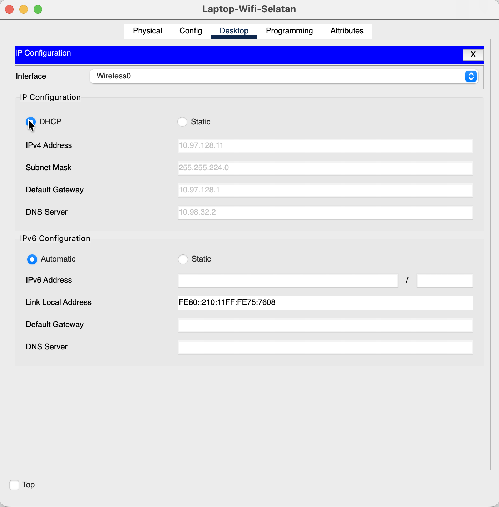

  - PC-PJU-Selatan

    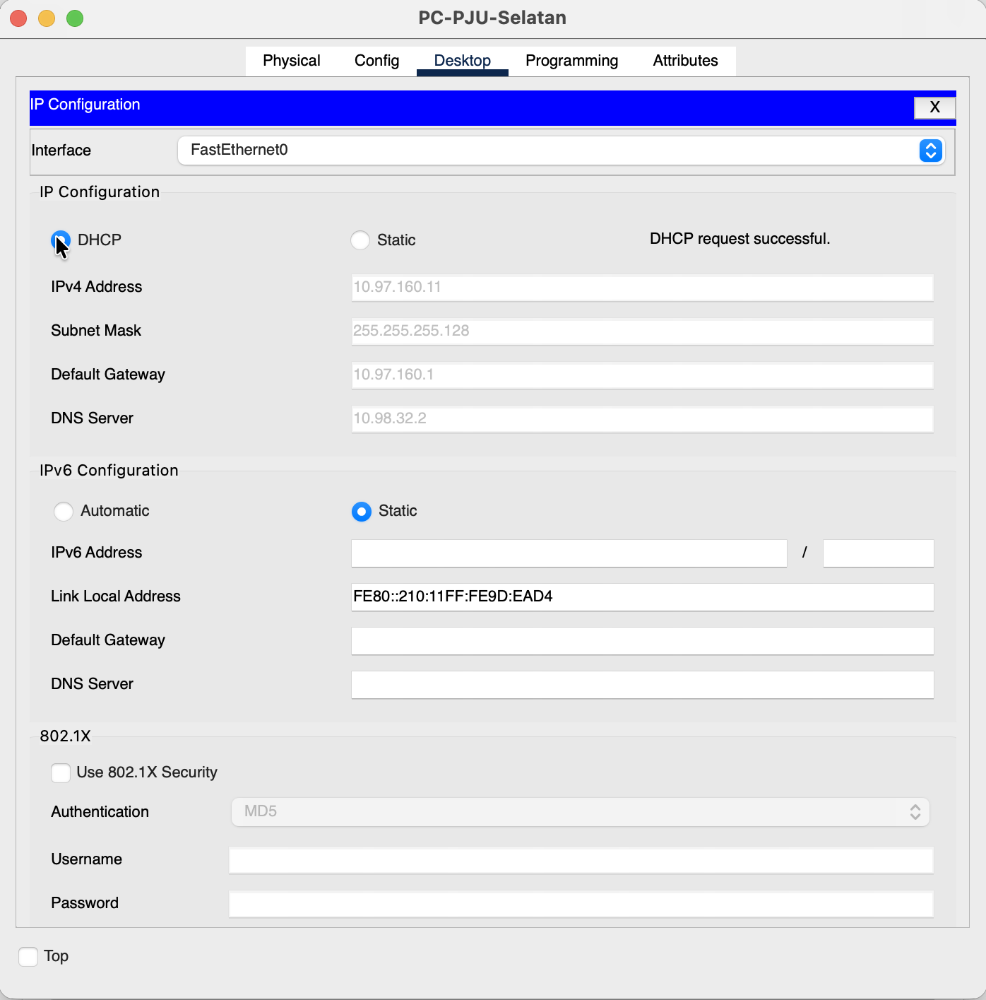

- Wilayah Timur

  - Laptop-Wifi-Timur

    

  - PC-Sensor-Banjir

    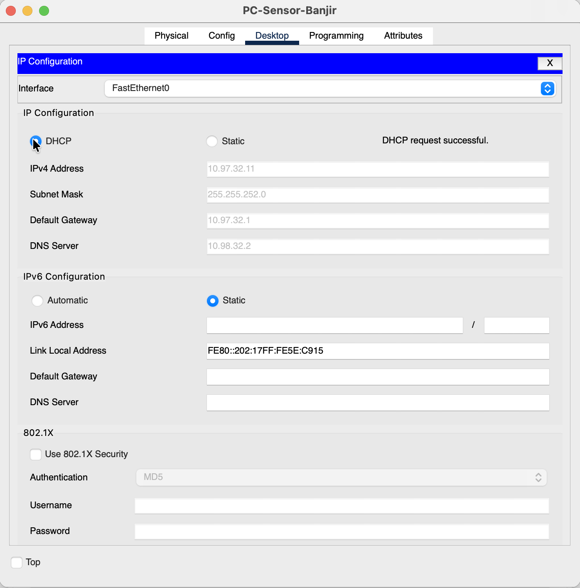

- Wilayah Barat

  - Laptop-Wifi-Barat

    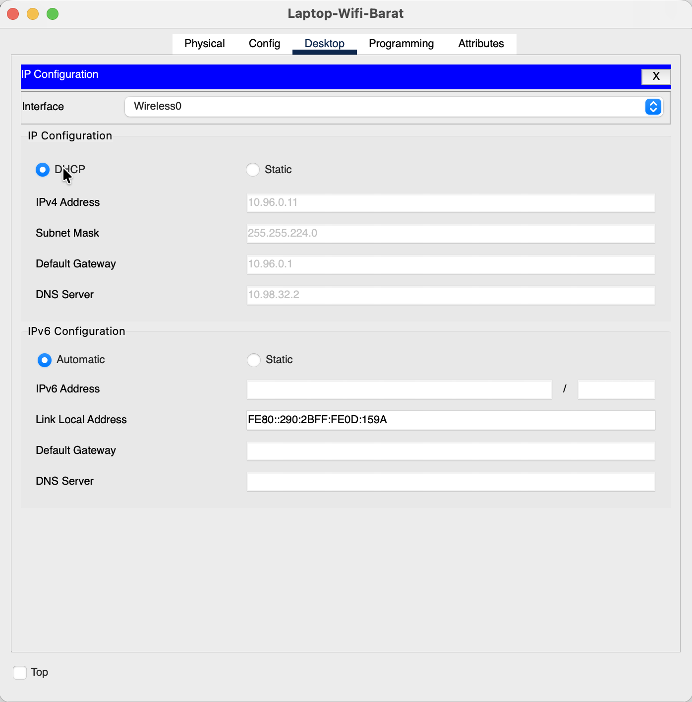

  - PC-Puskesmas-Barat

    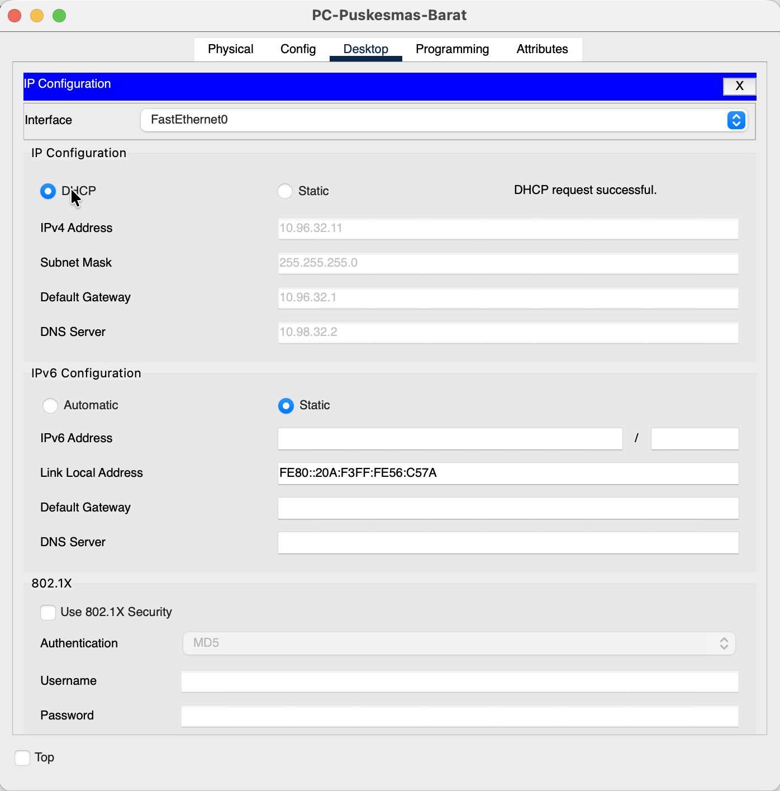


### Soal 8 - Layanan Aplikasi Smart City

Domain internal kelompok kami adalah **`k12.smartcity.lab`** (12 = nomor kelompok). Layanan yang dipasang:

| Layanan | Server | IP | LAN (router) | Alasan |
|---|---|---|---|---|
| DNS | SRV-DC | 10.98.32.2 | Server & Storage DC (R-DC) | Satu sumber DNS untuk seluruh kota, ada di Command Center |
| FTP (rekaman CCTV) | SRV-DC | 10.98.32.2 | Server & Storage DC (R-DC) | Rekaman CCTV disimpan di DC |
| Email | SRV-DC | 10.98.32.2 | Server & Storage DC (R-DC) | SMTP/POP3 satu titik untuk semua pegawai |
| Web Portal | SRV-BALAIKOTA | 10.99.8.2 | Server Balai Kota (R-PUSAT) | Portal resmi pemerintahan ada di Balai Kota |

### IP Statis Server

| Server | IP | Mask | Gateway | DNS |
|---|---|---|---|---|
| SRV-DC | 10.98.32.2 | 255.255.255.0 | 10.98.32.1 | 10.98.32.2 |
| SRV-BALAIKOTA | 10.99.8.2 | 255.255.255.224 | 10.99.8.1 | 10.98.32.2 |

### Konfigurasi Layanan

**DNS (SRV-DC > Services > DNS).** DNS Service **On**, lalu tambah record Type A:

| Name | Type | Address |
|---|---|---|
| www.k12.smartcity.lab | A | 10.99.8.2 |
| ftp.k12.smartcity.lab | A | 10.98.32.2 |
| mail.k12.smartcity.lab | A | 10.98.32.2 |

**Web (SRV-BALAIKOTA > Services > HTTP).** HTTP **On**, lalu isi `index.html` diganti dengan halaman "Portal Smart City Surabaya" yang mencantumkan Kelompok 12, domain internal, dan daftar layanan.

**FTP (SRV-DC > Services > FTP).** FTP **On**, tambah user `cctv` / `cctv12345` dengan permission Write, Read, Delete, Rename, List.

**Email (SRV-DC > Services > EMAIL).** SMTP dan POP3 **On**, domain `k12.smartcity.lab` (klik Set), lalu tambah user `pegawai1` / `pegawai123` dan `pegawai2` / `pegawai123`.

Konfigurasi email di klien (Desktop > Email > Configure Mail):

| Field | PC-Pegawai-Bk (Balai Kota) | PC-Kantor-Pelabuhan (Pelabuhan) |
|---|---|---|
| Your Name | Pegawai 1 | Pegawai 2 |
| Email Address | pegawai1@k12.smartcity.lab | pegawai2@k12.smartcity.lab |
| Incoming Mail Server | mail.k12.smartcity.lab | mail.k12.smartcity.lab |
| Outgoing Mail Server | mail.k12.smartcity.lab | mail.k12.smartcity.lab |
| User Name / Password | pegawai1 / pegawai123 | pegawai2 / pegawai123 |

### Pengujian Soal 8

- Tes DNS

  Dari PC-Kantor-Pelabuhan (wilayah Pelabuhan, beda wilayah dengan server):

  ```nslookup www.k12.smartcity.lab```

  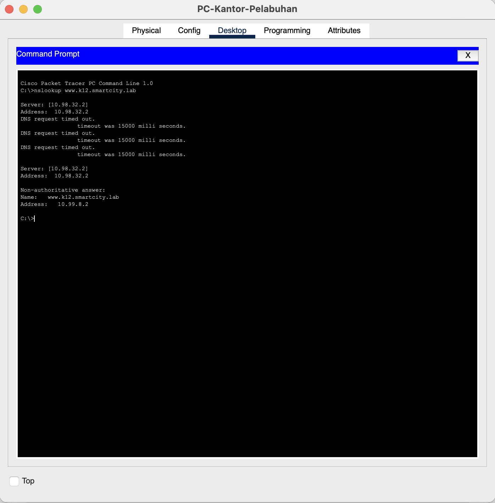

  Percobaan pertama sempat timeout karena tabel ARP di jalur antar-router belum terisi. Percobaan berikutnya berhasil: server DNS 10.98.32.2 menjawab `www.k12.smartcity.lab` = 10.99.8.2.

- Tes Web

  Dari PC-Kantor-Pelabuhan, buka Desktop > Web Browser:

  ```http://www.k12.smartcity.lab```

  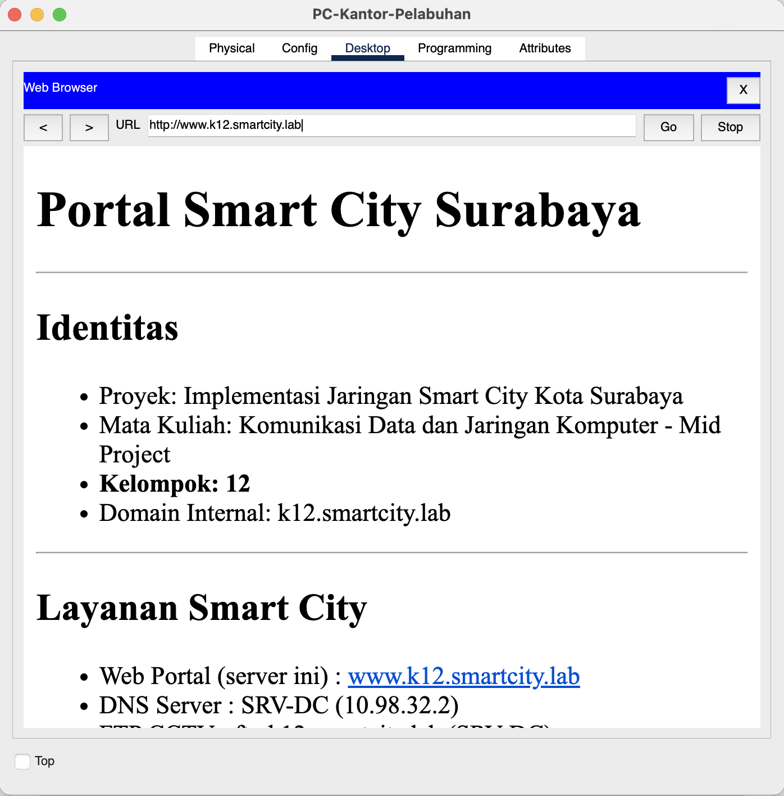

  Halaman "Portal Smart City Surabaya" dengan identitas Kelompok 12 tampil. Portal dibuka memakai nama domain, bukan IP, jadi DNS dan HTTP sama-sama berfungsi.

- Tes FTP

  Dari PC-Cctv-Kota, buat file `rekaman1.txt` lewat Desktop > Text Editor, lalu upload ke server:

  ```
  ftp ftp.k12.smartcity.lab
  Username: cctv
  Password: cctv12345
  put rekaman1.txt
  dir
  quit
  ```

  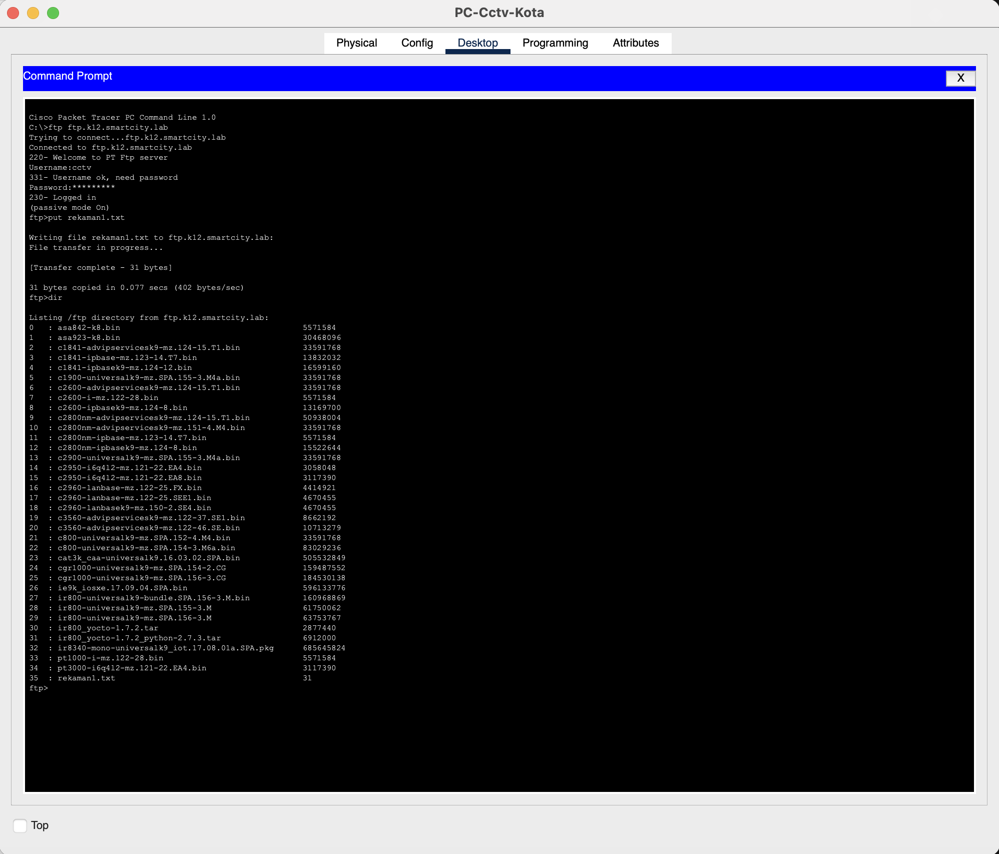

  Login berhasil (`230- Logged in`), file terkirim (`Transfer complete - 31 bytes`), dan `rekaman1.txt` muncul di urutan terakhir hasil `dir`.

- Tes Email

  Kirim email dari pegawai1 (PC-Pegawai-Bk) ke pegawai2, lalu klik Receive di PC-Kantor-Pelabuhan:

  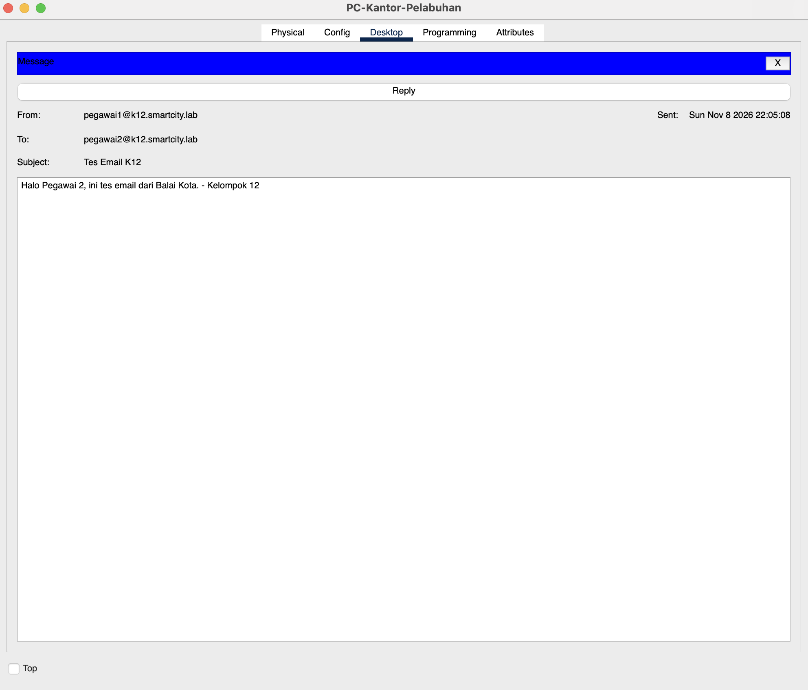

  Balas dari pegawai2 ke pegawai1, lalu klik Receive di PC-Pegawai-Bk:

  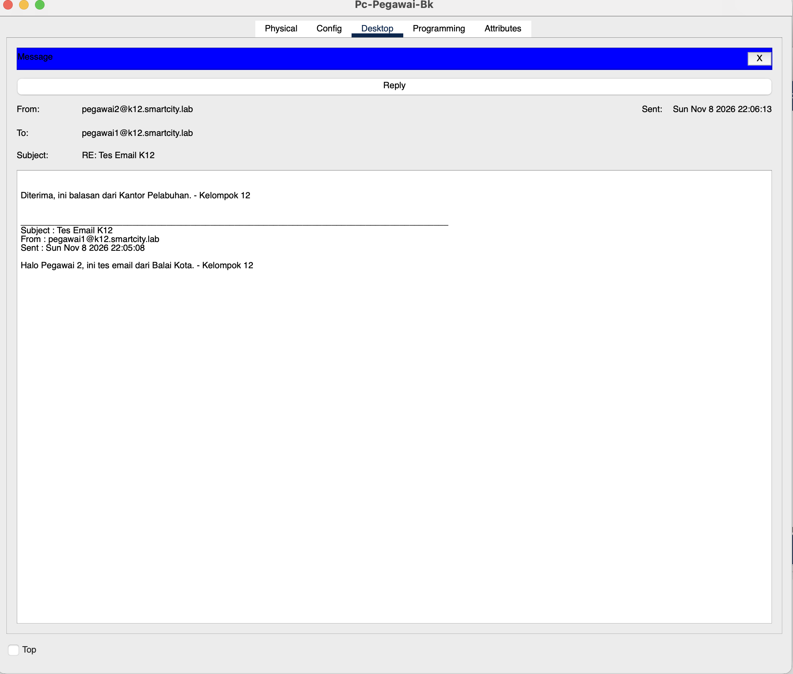

  Email terkirim dua arah antara Balai Kota dan Pelabuhan lewat server `mail.k12.smartcity.lab`.
